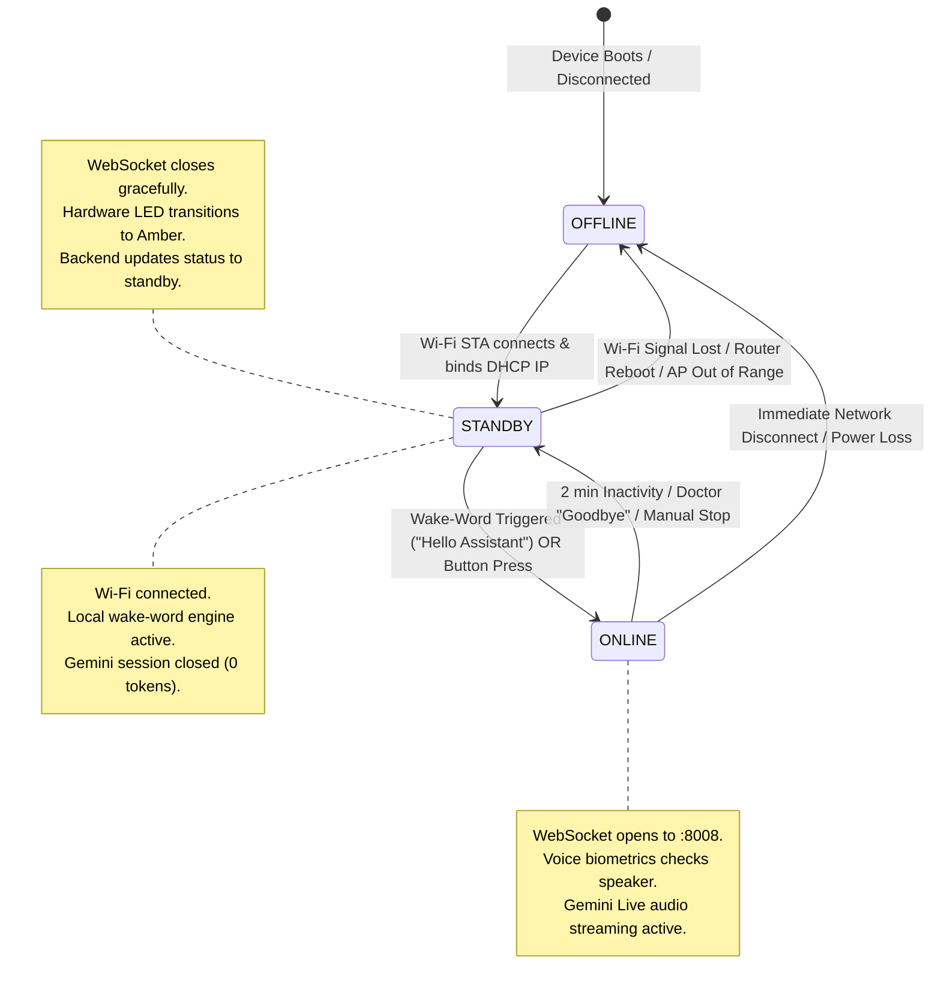

# YHealth Smart Speaker Modes Guide: Implementation, Architecture & Step-by-Step Technical Guide

---

## 1. Executive Summary & Objective

In the YHealth Smart Speaker healthcare ecosystem, every speaker in clinical and home environments operates in one of **three discrete operating modes**:

1. **ONLINE** (Active Consultation / Live Bi-directional Gemini Session)
2. **STANDBY** (Listening for Wake-Word locally / WebSocket paused / Zero AI Token Consumption)
3. **OFFLINE** (Disconnected from Wi-Fi / Powered down / Network interface unreachable)

This document provides a step-by-step, comprehensive guide detailing the **exact technical implementation**, state machine transitions, networking events, database schemas, and API status codes that govern how these modes operate without flapping, latency spikes, or desynchronization.

---

## 2. The Three Operating Modes Defined

| Metric / Feature | 🟢 ONLINE Mode | 🟡 STANDBY Mode | 🔴 OFFLINE Mode |
|---|---|---|---|
| **Wi-Fi Connectivity (`wifi_connected`)** | `true` | `true` | `false` |
| **WebSocket Connection (Port 8008)** | Active full-duplex session | Disconnected / Suspended | Closed / Unreachable |
| **Microphone & DSP State** | Streaming 16kHz PCM audio | Local wake-word detection only | Suspended / Muted |
| **Gemini AI Session** | Active Live Session (Bidi-stream) | Suspended (**0 Token Cost**) | Terminated |
| **Hardware LED Indicator** | Breathing Cyan / Green | Soft Amber Pulse / Idle | Solid Red / Off |
| **Dashboard UI Badge** | `● ONLINE` (Green) | `◐ STANDBY` (Amber) | `○ OFFLINE` (Red) |
| **Wi-Fi SSID & Signal (RSSI)** | Connected (e.g. `TFTus-WiFi`, `-48 dBm`) | Connected (e.g. `TFTus-WiFi`, `-48 dBm`) | `Wi-Fi Off` (`0 dBm` / No Carrier) |
| **HTTP Status Code Returned** | `200 OK` | `200 OK` | `200 OK` |

---

## 3. End-to-End Architectural State Machine



---

## 4. Step-by-Step Implementation Details

### Step 1: ESP32 Hardware Firmware (`main/main.c`)

The ESP32-S3 firmware manages hardware state transitions between full streaming and local low-power standby:

1. **Local Wake-Word Detection**:
   * While in `STANDBY` (`s_conv_state = CONV_STATE_SLEEP`), audio from the microphone array is processed **exclusively on-device** by the local wake-word engine.
   * Ambient room conversations, patient coughs, or background noise **never** trigger network traffic or consume AI tokens.
2. **Entering Standby Mode**:
   * When 2 minutes of silence pass or the doctor says "Goodbye", the device calls:
     ```c
     enter_sleep_mode("doctor goodbye sign-off");
     ```
   * It sends a JSON control frame down the WebSocket:
     ```json
     {"type": "device_sleep", "reason": "doctor goodbye sign-off"}
     ```
   * It closes the WebSocket gracefully and updates the LED ring to `CONV_STATE_SLEEP`.
3. **Waking Up to Online Mode**:
   * When the wake word ("Hello Assistant") is detected locally, `exit_sleep_mode()` triggers a background task (`xTaskNotifyGive(s_ws_maintenance_task_handle)`), initiating an immediate WebSocket handshake with the voice backend on port `8008`.

---

### Step 2: Edge Voice Backend (`backend/server.py`)

The voice backend acts as the bridge between hardware streaming and cloud AI:

1. **Connection Handshake**:
   * When the ESP32 opens the WebSocket, it passes its MAC address and Wi-Fi parameters in query parameters:
     ```text
     ws://127.0.0.1:8008/ws?device_id=288485b2bcb8&rssi=-48&ssid=TFTus-WiFi
     ```
   * The backend normalizes the identifier and immediately calls `_mark_device_online_in_fleet()`:
     ```python
     def _mark_device_online_in_fleet(device_label, ip, ssid, rssi):
         _mark_device_status_in_fleet(device_label, "online", "Wake Word Triggered / WebSocket Live Active", True, ip=ip, ssid=ssid, rssi=rssi)
     ```
2. **Idle Standby Detection**:
   * If the WebSocket receives `device_sleep` or idle timeout triggers, it immediately calls:
     ```python
     _mark_device_standby_in_fleet(device_label, ip, ssid, rssi)
     ```
   * This posts an update to the fleet ecosystem server (`:8010/api/speakers/{id}/status`) so the dashboard reflects `STANDBY` within milliseconds.
3. **Disconnect / Power-Off Handling**:
   * When the WebSocket socket terminates (`WebSocketDisconnect`), the server marks the device as `STANDBY` if Wi-Fi was maintained, or `OFFLINE` if no heartbeat is received.

---

### Step 3: Fleet Ecosystem API & Status Codes (`web-dashboard/backend/app.py`)

The fleet management API on port `8010` is the single source of truth for the dashboard and external integrations.

#### A. Unified ID Resolution & Auto-Provisioning (Zero 404s)
In previous revisions, querying raw MAC addresses like `288485b2bcb8` returned `404 Not Found`.
Now, `apply_speaker_update()` normalizes all identifiers:
* Serial ID: `SPK-0000002`
* Standard MAC: `28:84:85:B2:BC:B8`
* Raw Hex: `288485b2bcb8`

If a newly unboxed speaker connects for the first time, the API **auto-provisions** the device in PostgreSQL and JSON storage and returns `HTTP 200 OK`:

```python
if target_idx == -1:
    new_spk = {
        "device_id": clean_id if clean_id.startswith("SPK-") else f"SPK-{clean_id[-6:]}",
        "mac_address": normalize_mac(clean_id),
        "role": "doctor",
        "name": "Dr. Brij Mohan Makkar",
        "status": updates.get("status", "online"),
        "wifi_connected": updates.get("wifi_connected", True),
        "wifi_ssid": updates.get("wifi_ssid", "TFTus-WiFi"),
        "wifi_isp": "Airtel Xstream Fiber",
        "wifi_rssi": updates.get("wifi_rssi", -48),
        "status_reason": updates.get("status_reason", "Auto-provisioned on network"),
        "last_seen_at": "Just now"
    }
    speakers.append(new_spk)
    save_db(speakers)
    return new_spk
```

#### B. API Endpoints & Status Codes

| Endpoint | Method | Payload / Params | Status Code | Return Structure |
|---|---|---|---|---|
| `/api/speakers/{id}/status` | `POST` | `{"status": "online", "wifi_connected": true}` | `200 OK` | `{"status": "status_updated", "speaker_status": "online"}` |
| `/api/speakers/{id}/status` | `POST` | `{"status": "standby", "wifi_connected": true}` | `200 OK` | `{"status": "status_updated", "speaker_status": "standby"}` |
| `/api/speakers/{id}/status` | `POST` | `{"status": "offline", "wifi_connected": false}` | `200 OK` | `{"status": "status_updated", "speaker_status": "offline"}` |
| `/api/speakers/{id}/heartbeat` | `POST` | `{"rssi": -48, "heap": 182400}` | `200 OK` | `{"status": "heartbeat_acknowledged"}` |
| `/api/speakers/{id}/network-event` | `POST` | `{"event": "WIFI_CONNECTED", "ssid": "..."}` | `200 OK` | `{"status": "network_event_recorded"}` |

---

### Step 4: Frontend Real-Time Presentation (`App.jsx`)

The React dashboard provides real-time status management:

1. **3-Mode Switcher Controls**:
   * Dedicated buttons for **● Online**, **◐ Standby**, and **○ Offline** allow administrators to immediately set a device's mode.
   * Clicking a button sends a `POST` request to `/api/speakers/{id}/status` and updates the local React state optimistically.
2. **Wi-Fi Toggle & Telemetry**:
   * Clicking the Wi-Fi icon toggles between `wifi_connected: true` and `wifi_connected: false`.
   * Toggling Wi-Fi off automatically transitions the status badge to `○ OFFLINE`.
   * Displays the active **SSID** (`TFTus-WiFi`), **ISP** (`Airtel Xstream Fiber`), and signal strength (`-48 dBm`).
3. **Sanitized Presentation**:
   * Regex sanitization (`replace(/\s*\([^)]*\)/g, '')`) ensures internal placement notes (like `Unit 2 / Clinic Desk`) and developer badges (`CMS-MFCC + F0`) are hidden from clinical staff.

---

## 5. Verification Checklist

To verify that modes are operating as expected:

1. **ONLINE Mode Verification**:
   * Send command:
     ```bash
     python -c "import urllib.request, json; print(urllib.request.urlopen(urllib.request.Request('http://127.0.0.1:8010/api/speakers/SPK-0000002/status', data=b'{\"status\":\"online\",\"wifi_connected\":true}', headers={'Content-Type':'application/json'})).getcode())"
     ```
   * Output: `200`
   * Dashboard: Shows green `● ONLINE` badge with active link latency.

2. **STANDBY Mode Verification**:
   * Send command:
     ```bash
     python -c "import urllib.request, json; print(urllib.request.urlopen(urllib.request.Request('http://127.0.0.1:8010/api/speakers/SPK-0000002/status', data=b'{\"status\":\"standby\",\"wifi_connected\":true}', headers={'Content-Type':'application/json'})).getcode())"
     ```
   * Output: `200`
   * Dashboard: Shows amber `◐ STANDBY` badge; Gemini token consumption stops.

3. **OFFLINE Mode Verification**:
   * Send command:
     ```bash
     python -c "import urllib.request, json; print(urllib.request.urlopen(urllib.request.Request('http://127.0.0.1:8010/api/speakers/SPK-0000002/status', data=b'{\"status\":\"offline\",\"wifi_connected\":false}', headers={'Content-Type':'application/json'})).getcode())"
     ```
   * Output: `200`
   * Dashboard: Shows red `○ OFFLINE` badge and `Wi-Fi Off` indicator.
