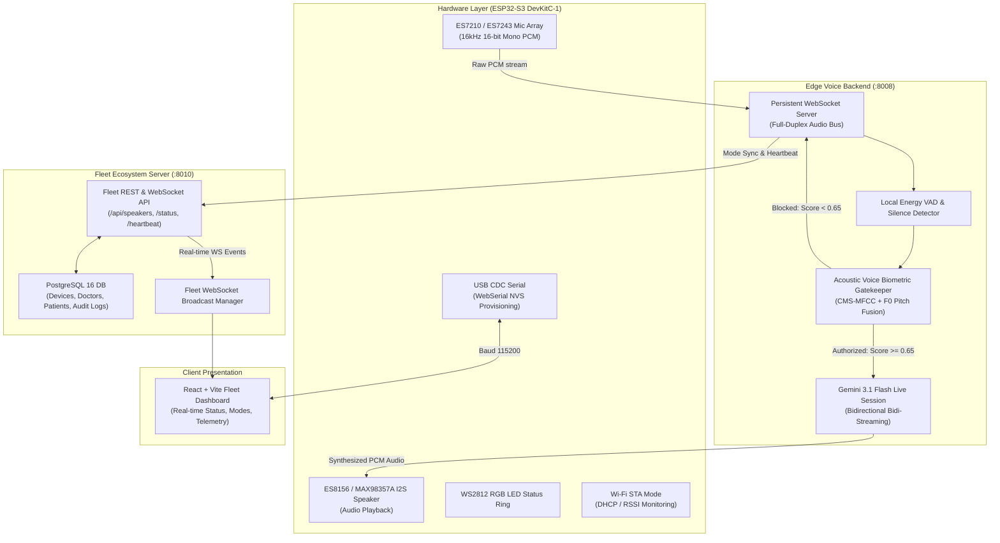
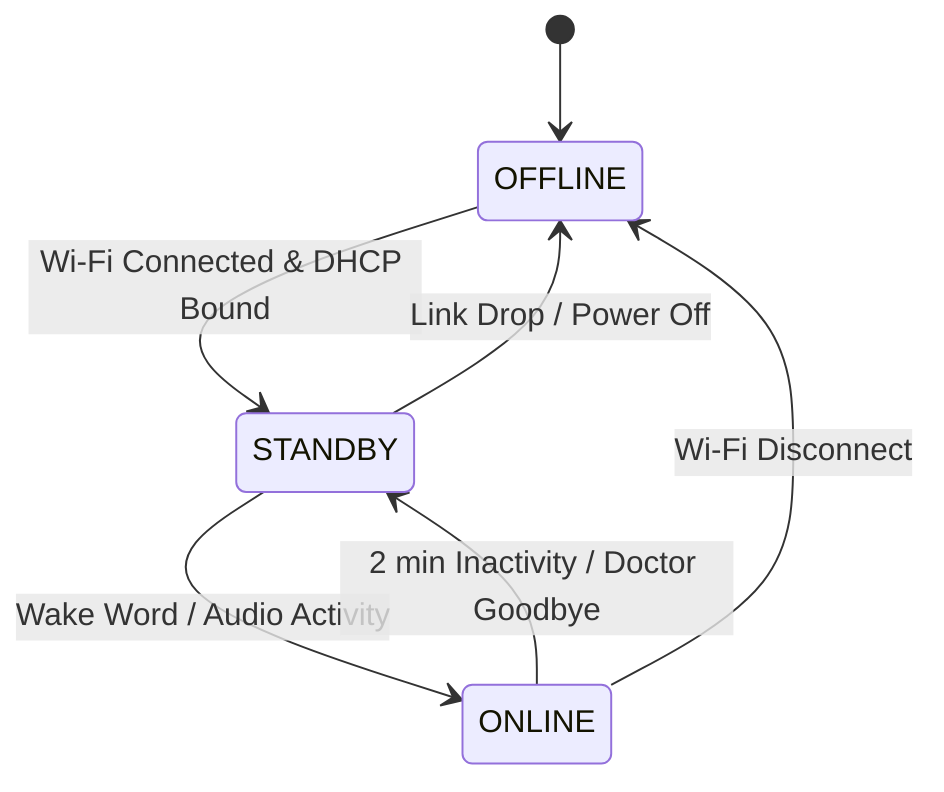

# YHealth Healthcare Assistant — Architecture & Technical Specifications

This document outlines the end-to-end architecture, technology stack, and implementation mechanics of the **YHealth Healthcare Assistant & Smart Speaker Fleet**.

---

## 1. High-Level Architecture Overview



---

## 2. Core Technology Stack

| Domain | Technology / Component | Purpose & Role |
|---|---|---|
| **Embedded Hardware** | ESP32-S3 (Xtensa Dual-Core 240MHz, 8MB PSRAM) | On-device microphone sampling, I2S DAC output, local wake-word, and LED state control. |
| **Firmware SDK** | ESP-IDF v5.x (FreeRTOS, C99) | Low-latency audio pipeline (I2S DMA buffers, ring buffers, non-blocking network tasks). |
| **Edge Voice Engine** | Python 3.11, FastAPI, Uvicorn, WebSockets | Ingests real-time 16kHz audio from speakers and orchestrates Gemini sessions. |
| **Biometrics & DSP** | NumPy, SciPy (Signal & FFT), Librosa algorithms | CMS-MFCC extraction, multi-frame autocorrelation F0 pitch analysis, and cosine fusion scoring. |
| **AI LLM Live Engine** | Google Gemini 3.1 Flash Live (bidi-streaming) | Full-duplex clinical assistant with real-time audio response and doctor conversational turns. |
| **Fleet Management** | FastAPI (:8010), PostgreSQL 16 (JSONB telemetry) | Fleet device registry, heartbeat tracking, audit logging, and WebSerial provisioning. |
| **Frontend UI** | React 18, Vite, Lucide Icons, Web Serial API | Clinic admin portal for device monitoring, Wi-Fi control, and 3-step voice enrollment. |

---

## 3. Real-Time Acoustic Voice Biometrics (The Gatekeeper)

To comply with HIPAA healthcare access rules, patient medical records must never be disclosed to unauthorized voices. Every utterance through the speaker is verified before reaching Gemini.

### 3.1 Feature Extraction Pipeline
1. **Audio Pre-processing**: 16kHz 16-bit mono PCM is windowed into 25ms frames with 10ms hop size.
2. **Pre-emphasis**: $y[t] = x[t] - 0.97 \cdot x[t-1]$ boosts high-frequency formants.
3. **Mel-Filterbank**: 26 triangular Mel-spaced filters map frequencies from 100 Hz to 7500 Hz.
4. **Cepstral Mean Subtraction (CMS)**: Normalizes room acoustics, microphone coloration, and distance variations.
5. **64-Dimensional Biometric Embedding**:
   * **Dimensions 1–16**: Mean MFCCs (static vocal tract resonance).
   * **Dimensions 17–32**: Standard Deviation of MFCCs (articulatory movement dynamics).
   * **Dimensions 33–48**: 16-band energy spectrum (formant distribution).
   * **Dimensions 49–64**: Spectral centroid, flux, and stability statistics.
6. **Multi-Frame Normalized Pitch ($F_0$)**:
   * Evaluates autocorrelation peaks across voiced segments where periodicity $> 0.25$.
   * Takes the median across multiple voiced windows to ignore unvoiced consonants (e.g., "s", "t", "h").

### 3.2 Biometric Multi-Factor Fusion Formula

The match score is derived by combining spectral vocal tract similarity ($\text{Sim}_{\text{cosine}}$) and fundamental pitch congruence ($C_{\text{pitch}}$):

$$\text{Score} = 
\begin{cases} 
0.75 \cdot \text{Sim}_{\text{cosine}} + 0.25 \cdot C_{\text{pitch}} & \text{if } \text{Sim}_{\text{cosine}} \ge 0.85 \\
0.60 \cdot \text{Sim}_{\text{cosine}} + 0.40 \cdot C_{\text{pitch}} & \text{if } C_{\text{pitch}} \ge 0.25 \\
0.45 \cdot \text{Sim}_{\text{cosine}} + 0.55 \cdot C_{\text{pitch}} & \text{otherwise}
\end{cases}$$

* **Match Threshold**: $\text{Score} \ge 0.65$ authorizes access.
* **Octave Awareness**: Natural pitch variations, octave doubling ($2 \times F_0$), or halving ($F_0 / 2$) are normalized.
* **Zero First-Word Loss**: Upon verification, the initial ~600ms buffer is flushed into Gemini's streaming queue so greeting words like "Hello" are not lost.

---

## 4. Speaker Operational Modes & Status Synchronization

The system synchronizes three distinct states between hardware, servers, and the UI:



### 4.1 Mode Matrix

| Mode | Wi-Fi State | WebSocket (:8008) | Mic / DSP | Gemini Session | HTTP Status Code |
|---|---|---|---|---|---|
| **ONLINE** | Connected (`True`) | Active Full-Duplex | Streaming PCM | Active Live Session | `200 OK` |
| **STANDBY** | Connected (`True`) | Halted / Idle | Local Wake-Word Mic | Suspended (0 Tokens) | `200 OK` |
| **OFFLINE** | Disconnected (`False`) | Closed | Suspended | Terminated | `200 OK` |

### 4.2 Status Code & Identifier Unification
* **MAC & Device ID Normalization**: Hardware endpoints accept standard IDs (`SPK-0000002`), formatted MACs (`28:84:85:B2:BC:B8`), and raw 12-character hex (`288485b2bcb8`).
* **Auto-Provisioning**: Incoming heartbeat or network status reports for unindexed devices automatically provision a record, eliminating `404 Not Found` errors in the fleet monitor.

---

## 5. Security Model & Anti-Overlap Safeguards

1. **Acoustic Anti-Overlap Guard**:
   * When an unauthorized voice is blocked, the rejection announcement is rate-limited to at most once per 6 seconds.
   * Prevents acoustic feedback loops where the speaker's own output triggers re-verification.
2. **Web Serial Hardware USB Provisioning**:
   * Uses browser Web Serial API to flash Wi-Fi credentials directly to the ESP32's non-volatile storage (`NVS`) at 115,200 baud using the formatted command:
     ```text
     SET_WIFI:<ssid>:<password>\n
     ```
   * Safely releases the reader lock before closing the port to prevent port freezing.
3. **Audit Trail**: Every unauthorized attempt logs the device ID, timestamp, pitch delta, and confidence score to PostgreSQL for HIPAA compliance tracking.
